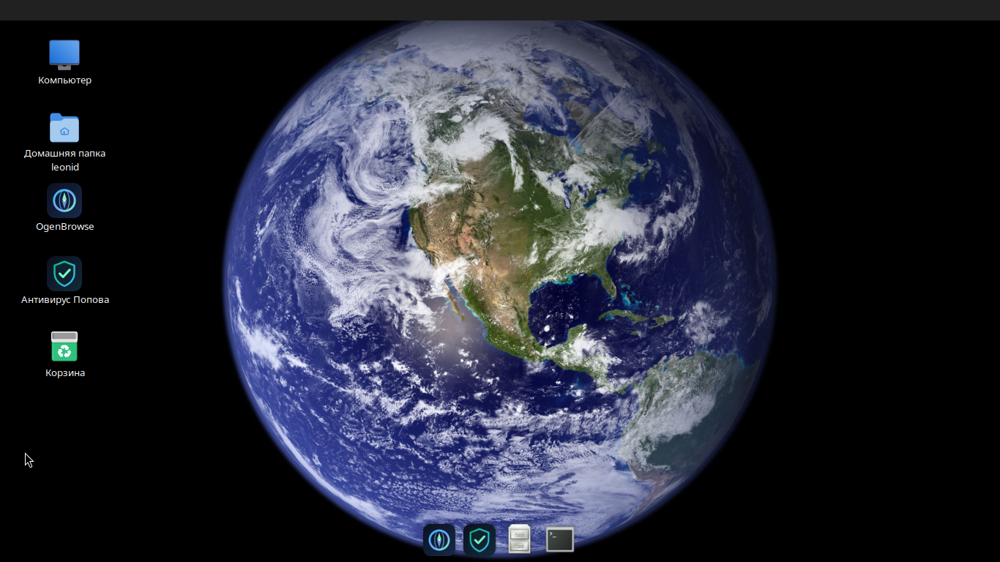
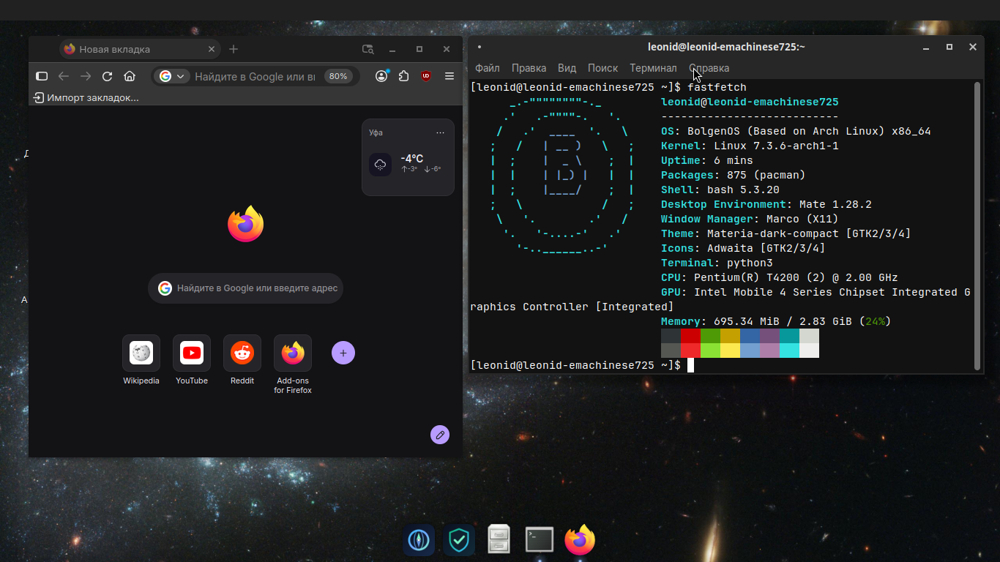
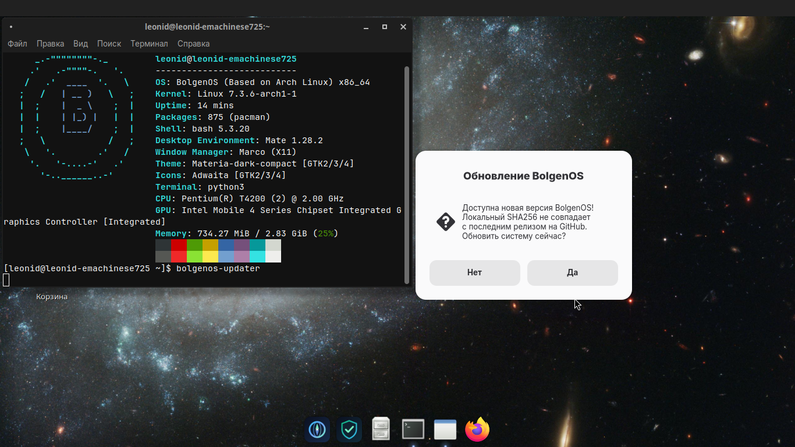
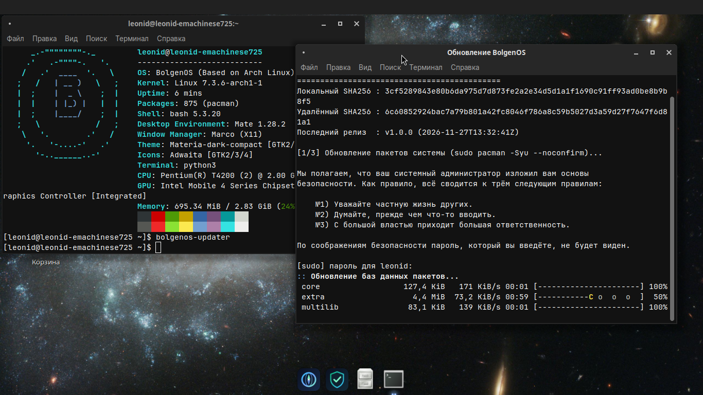

<div align="center">

# BolgenOS

**«Принципиально новая ОС» — Arch Linux-based Live/Install distribution with non-boring wallpapers, OgenBrowse, Popov Antivirus, custom `dash-shell`, and SHA256 GitHub release updater.**

[](README.ru.md)
[-1793D1?logo=arch-linux&logoColor=white)](https://archlinux.org/)
[](https://github.com/icuxu-tg/BolgenOS/releases/latest)
[](https://github.com/icuxu-tg/BolgenOS/actions/workflows/build-iso.yml)

</div>

---

## Screenshots

| Desktop (MATE + Plank) | Fastfetch & OgenBrowse |
| :---: | :---: |
|  |  |

| GitHub SHA256 Update Prompt | Interactive System Upgrade |
| :---: | :---: |
|  |  |

---

## Key Features

- **Desktop & Visual Polish**
  - **MATE Desktop + Plank dock + Picom compositor**, styled with `Materia-dark`, `Papirus-Dark`, `Inter`, and `JetBrains Mono`.
  - **16 Non-Boring Wallpapers** (`/usr/share/bolgenos/backgrounds/`): 10 custom SVG artworks + 6 high-resolution space & landscape JPEGs.
  - Custom **Plymouth** boot splash, **GRUB** / **Syslinux** boot themes, and custom **`fastfetch`** ASCII logo (`/etc/fastfetch/bolgenos.txt`).
- **Custom Terminal Shell (`dash-shell`)**
  - Python3 interactive fish/dash-inspired shell set as the default shell in `mate-terminal` (`/usr/local/bin/dash-shell`).
  - Live syntax highlighting, gray history/command autosuggestions, `Tab` completion, `Ctrl+R` search, `$((...))` arithmetic, pipelines, and `/etc/dashrc` aliases (`ll`, `la`, `ff`, `up`).
- **Installer with DE Choice (`Calamares`)**
  - **MATE + Plank** pre-baked for full **offline installation** by default.
   - Optional online installation of **KDE Plasma 6**, **XFCE**, **Cinnamon**, or **GNOME** right from the Calamares `packagechooser@de` step.
- **Preinstalled Apps & Utilities**
  - **OgenBrowse** (`firefox` + `firefox-i18n-ru`)
   - **Popov Antivirus** (`clamtk` + Caja context-menu scan script + `clamav-freshclam.service`)
   - **GameHub** (`bolgenos-gamehub`): native GTK3 gaming center — scans installed games, launches them, and installs Steam / Lutris / Wine / Heroic / MangoHud / GameMode / vkBasalt from catalog.
  - **BolgenOS Welcome** (`bolgenos-welcome`): GTK3 welcome hub with wallpaper preview & switcher, `pacman`/`yay` package search, NVIDIA driver helper, Timeshift & system tweaks.
  - **BolgenOS Updater** (`bolgenos-updater`): compares `/etc/bolgenos-release.sha256` against [`RELEASE_SHA256.txt`](https://github.com/icuxu-tg/BolgenOS/releases/latest) at login and triggers interactive upgrades.
   - **Productivity & Recovery:** VLC, PipeWire + `pavucontrol`, Engrampa, GParted, `man-db`, UFW/GUFW, Timeshift, Snapper + `grub-btrfs`, `zram-generator`, Bluetooth, CUPS, and VM guest agents (`qemu-guest-agent`, `spice-vdagent`, `virtualbox-guest-utils`).
   - **Hardware & network extras:** `pciutils`, `gnome-keyring`, `gvfs-smb`/`gvfs-nfs`, `sane-airscan`, `cups-pdf`.
   - **Slim ISO (~2 GB):** bundled firmware is `linux-firmware-intel` + `linux-firmware-realtek`; other firmware, `base-devel`, and extra fonts can be installed later with `pacman`/`yay`.
- **Ready-to-Use `pacman` Setup**
  - Preconfigured HTTPS Arch mirrors (`/etc/pacman.d/mirrorlist`) and automatic GPG keyring initialization (`bolgenos-pacman-init.service`) in both Live ISO and installed systems.

---

## Live Session Credentials

| Mode | Username | Password | Notes |
| :--- | :--- | :--- | :--- |
| **Live GUI (MATE)** | `popov` | *(none)* | Automatic login enabled, passwordless `sudo` |
| **Live TTY** | `popov` or `root` | *(none)* | Press `Enter` on password prompt |
| **Installed System** | *(your choice)* | *(your choice)* | Configured during Calamares installation |

---

## Building from Source (Arch Linux `x86_64`)

1. Install build tools on an Arch Linux host:
   ```bash
   sudo pacman -S --needed archiso base-devel git sudo
   ```
2. Build the local AUR repository (`yay` and `calamares` with `packagechooser` enabled) into `/srv/bolgenos-localrepo` as a **regular user** (not `root`):
   ```bash
   ./prepare-aur-localrepo.sh
   ```
3. Build the ISO, `.iso.sha256`, and `RELEASE_SHA256.txt` as `root`:
   ```bash
   sudo ./release.sh
   ```
   Output artifacts are generated in `./out/`.

> Automated builds and releases are also configured via GitHub Actions in [`.github/workflows/build-iso.yml`](.github/workflows/build-iso.yml).
