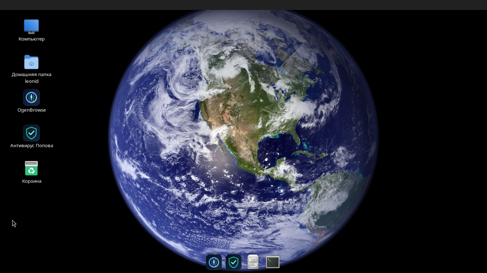
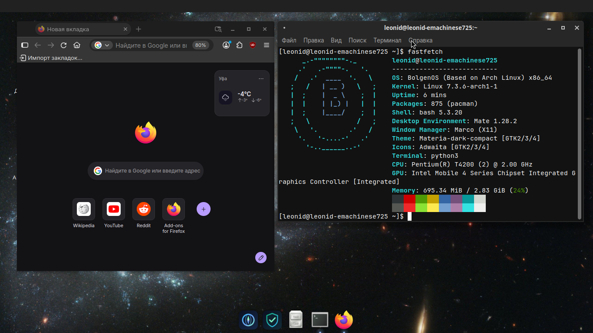
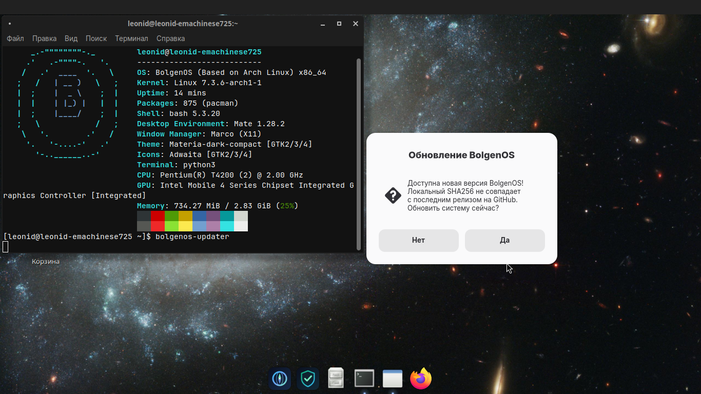
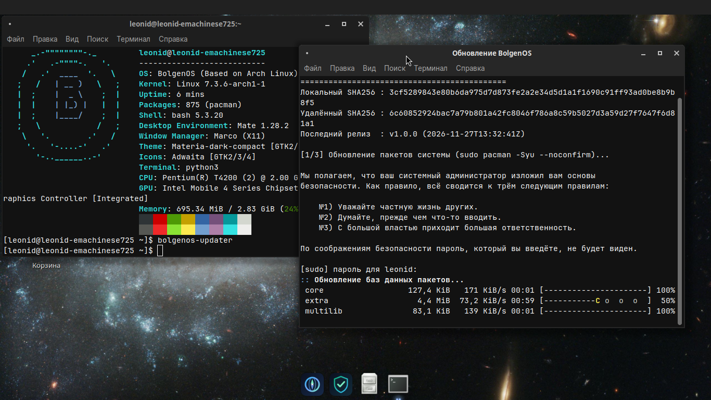

<div align="center">

# BolgenOS

**«Принципиально новая ОС» на базе Arch Linux (`archiso`) с нескучными обоями, OgenBrowse, Антивирусом Попова, собственной оболочкой `dash-shell` и автопроверкой обновлений через GitHub Releases.**

[](README.md)
[-1793D1?logo=arch-linux&logoColor=white)](https://archlinux.org/)
[](https://github.com/icuxu-tg/BolgenOS/releases/latest)
[](https://github.com/icuxu-tg/BolgenOS/actions/workflows/build-iso.yml)

</div>

---

## Скриншоты

| Рабочий стол (MATE + Plank) | Fastfetch и OgenBrowse |
| :---: | :---: |
|  |  |

| Уведомление об обновлении (SHA256) | Интерактивное обновление в терминале |
| :---: | :---: |
|  |  |

---

## Основные возможности

- **Рабочий стол и оформление**
  - **MATE + док Plank + композитор Picom**, тема `Materia-dark`, иконки `Papirus-Dark`, шрифты `Inter` и `JetBrains Mono`.
  - **16 нескучных обоев** (`/usr/share/bolgenos/backgrounds/`): 10 векторных SVG и 6 HD-фотографий космоса и природы.
  - Фирменный экран загрузки **Plymouth**, оформление **GRUB** / **Syslinux** и кастомный ASCII-логотип **`fastfetch`** (`/etc/fastfetch/bolgenos.txt`).
- **Собственная оболочка терминала (`dash-shell`)**
  - Интерактивный Python3-интерпретатор в духе fish/dash, настроенный по умолчанию в `mate-terminal` (`/usr/local/bin/dash-shell`).
  - Подсветка синтаксиса на лету, серые подсказки из истории и команд, дополнение по `Tab`, поиск `Ctrl+R`, арифметика `$((...))`, пайпы и алиасы в `/etc/dashrc` (`ll`, `la`, `ff`, `up`).
- **Установщик Calamares с выбором рабочего стола**
  - **MATE + Plank** вшит в образ и устанавливается **офлайн** по умолчанию.
   - При наличии интернета прямо в установщике (`packagechooser@de`) можно выбрать **KDE Plasma 6**, **XFCE**, **Cinnamon** или **GNOME**.
- **Предустановленные программы и утилиты**
  - **OgenBrowse** (`firefox` + `firefox-i18n-ru`)
   - **Антивирус Попова** (`clamtk` + пункт проверки в контекстном меню Caja + `clamav-freshclam.service`)
   - **GameHub** (`bolgenos-gamehub`): игровой центр на GTK3 — находит установленные игры, запускает их и ставит Steam / Lutris / Wine / Heroic / MangoHud / GameMode / vkBasalt из каталога.
  - **BolgenOS Welcome** (`bolgenos-welcome`): GTK3-приложение с превью и сменой обоев, поиском/установкой пакетов (`pacman` / `yay`), автонастройкой NVIDIA, Timeshift и твиками.
  - **BolgenOS Updater** (`bolgenos-updater`): сверяет `/etc/bolgenos-release.sha256` с последним [`RELEASE_SHA256.txt`](https://github.com/icuxu-tg/BolgenOS/releases/latest) один раз на релиз и предлагает **Обновить / Пропустить эту версию / Напомнить позже**. Затем выполняет `pacman -Syu` (ядро, драйверы, рабочий стол, программы) и обновляет компоненты BolgenOS (свои приложения, обои, иконки, dash-shell) из GitHub-релиза. Вручную: `bolgenos-updater --apply-update`, статус: `bolgenos-updater --status`.
   - **Система и мультимедиа:** VLC, PipeWire + `pavucontrol`, Engrampa, GParted, `man-db`, UFW/GUFW, Timeshift, Snapper + `grub-btrfs`, `zram-generator`, Bluetooth, CUPS, а также гостевые утилиты VM (`qemu-guest-agent`, `spice-vdagent`, `virtualbox-guest-utils`).
   - **Железо и сеть:** `pciutils`, `gnome-keyring`, `gvfs-smb`/`gvfs-nfs`, `sane-airscan`, `cups-pdf`.
   - **Компактный ISO (~2 ГБ):** в образе только `linux-firmware-intel` и `linux-firmware-realtek`; остальное firmware, `base-devel` и дополнительные шрифты ставятся позже через `pacman`/`yay`.
- **Работающий «из коробки» `pacman`**
  - Заранее прописанные HTTPS-зеркала (`/etc/pacman.d/mirrorlist`) и автоинициализация GPG-ключей (`bolgenos-pacman-init.service`) как в Live-режиме, так и после установки.

---

## Данные для входа

| Режим | Логин | Пароль | Примечание |
| :--- | :--- | :--- | :--- |
| **Live-сессия (MATE)** | `popov` | *(пустой)* | Настроен автологин, `sudo` работает без пароля |
| **Live TTY (консоль)** | `popov` или `root` | *(пустой)* | Просто нажмите `Enter` при запросе пароля |
| **Установленная система** | *(ваш логин)* | *(ваш пароль)* | Задаётся в установщике Calamares |

---

## Сборка из исходников (Arch Linux `x86_64`)

1. Установите зависимости для сборки на Arch Linux:
   ```bash
   sudo pacman -S --needed archiso base-devel git sudo
   ```
2. От **обычного пользователя** (не `root`) соберите локальный AUR-репозиторий (`yay` и `calamares` с включённым модулем `packagechooser`) в `/srv/bolgenos-localrepo`:
   ```bash
   ./prepare-aur-localrepo.sh
   ```
3. От `root` запустите сборку ISO и генерацию контрольных сумм:
   ```bash
   sudo ./release.sh
   ```
   Готовые `.iso`, `.iso.sha256` и `RELEASE_SHA256.txt` появятся в каталоге `./out/`.

> Автоматическая сборка и публикация релизов также настроены в GitHub Actions ([`.github/workflows/build-iso.yml`](.github/workflows/build-iso.yml)).
